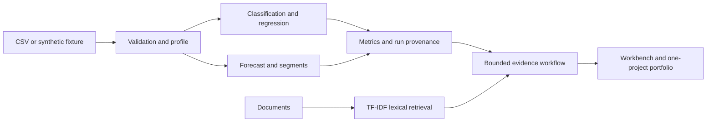

# Architecture and implementation boundary

DataPilot has two deliberately different execution modes.

**Local application:** FastAPI serves a vanilla JavaScript frontend and runs pandas/scikit-learn workflows. A single local workspace accepts CSV uploads and text-based TXT/Markdown/PDF documents. Source CSVs remain in process memory; local documents and append-only SQLite experiment metadata live in ignored `.datapilot/` storage. This is a single-user application bound to loopback, not a multi-tenant production service.

**Hosted replay:** the same interface reads `frontend/demo-snapshot.json`. That file is built only from the deterministic synthetic fixture, not the current upload workspace. It contains measured experiment results, bounded previews, authored demo documents and saved evidence reports. Training, upload and live assistant controls must identify their local-only status. No Python server or model provider runs on the static host.

Models compare predeclared baselines and estimators on a chronological holdout when `purchase_date` exists; generic CSVs without that column use an explicitly labeled random holdout. Learned preprocessing fits training rows only. Delivery outcomes, review fields, identifiers and dates are excluded from order-time predictors. When supplied, `outcome_available_date` also purges training labels unavailable at the cutoff.

Column-name gates cannot establish information availability for arbitrary datasets. Users must define their prediction time and input semantics. Forecast evaluation is rolling one-day prediction; the displayed 14-day recursive forecast is a separate artifact and its long-horizon interval coverage is not validated.

The assistant's default is deterministic. If LangGraph is installed, it runs plan, retrieve, compose and validate nodes with bounded control flow. LangChain provider synthesis is opt-in, limited to documentary answers, and has not been verified against a paid provider in the bundled demo. Citation-index checks do not establish claim entailment. TF-IDF is a lexical baseline, not dense embeddings, hybrid retrieval or a neural reranker.

Security scope: no arbitrary Python execution, no generated SQL execution, bounded uploads, no secrets in frontend assets. Keep the Python API local until authentication, quotas, workspace isolation and background job controls are implemented. The Docker Compose port is loopback-only.

