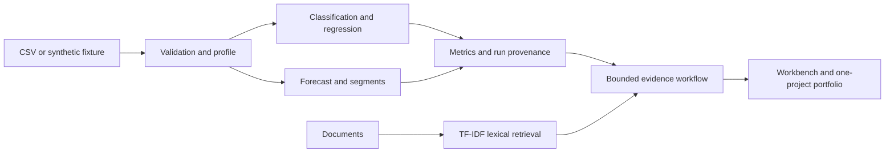

# Architecture and implementation boundary

DataPilot has two deliberately different execution modes.

**Local application:** FastAPI serves a vanilla JavaScript frontend and runs pandas/scikit-learn workflows. A single local workspace accepts CSV uploads and text-based TXT/Markdown/PDF documents. Source CSVs remain in process memory; local documents and append-only SQLite experiment metadata live in ignored `.datapilot/` storage. This is a single-user application bound to loopback, not a multi-tenant production service.

**Public Olist workspace:** the interface reads `frontend/olist-snapshot.json`. It contains real measured offline experiments, bounded source excerpts and exported logistic/ridge coefficients. New order predictions, ranked evidence search and report composition run in the visitor's browser. A separate numeric `olist-training-sample.json` powers `browser-training.js`, which fits baseline, linear/logistic and small random-forest models in a Web Worker. The 1,600/400 sample results remain separate from the full-data study. Arbitrary uploads and full-data training remain local-only. No Python server runs on the static host. An opt-in Pages Function provides the separate hosted LLM experiment described below. The separate `demo-snapshot.json` is a synthetic fallback used for testing.

Delivery models and segmentation use a delivered-order cohort. Forecasting counts every recorded order status in a separately declared historical window. Review classification uses nonempty Portuguese comments, recorded rating-group targets and review answer timestamps. These populations are explicitly different; the application does not merge them into a single denominator.

Models compare predeclared baselines and estimators on a chronological holdout when `purchase_date` exists; generic CSVs without that column use an explicitly labeled random holdout. Learned preprocessing fits training rows only. Delivery outcomes, review fields, identifiers and dates are excluded from order-time predictors. When supplied, `outcome_available_date` also purges training labels unavailable at the cutoff.

Column-name gates cannot establish information availability for arbitrary datasets. Users must define their prediction time and input semantics. Forecast evaluation is rolling one-day prediction; the displayed 14-day recursive forecast is a separate artifact and its long-horizon interval coverage is not validated.

The assistant's default is deterministic. If LangGraph is installed, it runs plan, retrieve, compose and validate nodes with bounded control flow. LangChain provider synthesis is opt-in, limited to documentary answers, and has not been verified against a paid provider in the bundled demo. Citation-index checks do not establish claim entailment. The original assistant keeps its lexical baseline; the separate retrieval study evaluates dense and hybrid retrieval.

## Research studies

`review-study.json` records a deeper rating-group experiment, independently of the original saved review model. Its protocol separates chronological fitting, validation-based candidate selection and later evaluation. It reports per-class errors, duplicate-text overlap and a subset whose normalized wording was absent from fitting and selection data. The protocol explicitly identifies the study as retrospective: the historical dataset and its earlier published holdout have already been inspected. A mechanically withheld partition alone does not make this an untouched external replication.

`retrieval-study.json` records the corpus, relevance questions, model provenance, evaluation and exported dense representations. The semantic encoder is a pretrained multilingual model; DataPilot does not train that encoder. The initial relevance labels were authored with AI assistance and are a seed benchmark for human review. Question splits and the declared selection rule keep development choices separate from reported test metrics, but this small same-corpus benchmark does not establish generalization to other companies or independent answer correctness.

The Research interface distinguishes saved experiments from live search. Semantic search is opt-in and downloads model assets before computing query embeddings in a background browser worker. Query text is processed on the visitor's device. Three English/Portuguese probes check tokenization and numerical compatibility. Because native and browser q8 outputs were not bit-identical, the live worker re-encodes the passage corpus and development questions in the browser, then selects browser thresholds using development questions only. Live and saved native-CPU scores can differ. Loading errors retain the existing lexical workflow. Reading saved studies and running the optional browser encoder need no embedding API or Python server. The separate live generation workflow calls a Pages Function.

See [the review study](REVIEW_STUDY.md), [the retrieval study](RETRIEVAL_STUDY.md) and [the technical walkthrough](WALKTHROUGH.md) for reproducibility and the remaining evaluation limits.

Security scope: no arbitrary Python execution, no generated SQL execution, bounded uploads, no secrets in frontend assets. Keep the Python API local until authentication, quotas, workspace isolation and background job controls are implemented. The Docker Compose port is loopback-only.

## Hosted generation

The Pages advanced-mode worker routes only `/api/generate` and `/api/generation-health`. Static assets bypass the Function. The build embeds the frozen 94-passage public corpus, lexical index and existing development-selected threshold. Visitors submit a bounded question, never their own system prompt, model identifier or source excerpts. The server retrieves up to three excerpts and calls the `AI` binding with a fixed Llama model, a 128-token output cap, temperature zero and seed 42. Hosted weights are not pinned; a model alias and seed do not guarantee repeatability.

The endpoint retains raw output, provider usage and reported termination metadata. It checks source labels and sentence citation coverage, and withholds drafts that fail the structural policy. That policy cannot establish whether a cited claim is true or entailed. Missing evidence still reaches the LLM with no excerpts; the saved refusal is actual model output. Infrastructure errors stay separate from model refusals.

Requests are limited to 8 KiB and questions to 1,000 characters. Cross-origin browser requests are rejected; this is not authentication or an abuse-proof quota. The public demo shares the account's free AI allowance, so one visitor can exhaust availability for others. It has no uploaded customer data, tool execution or API key in the frontend. Cancellation stops the browser waiting but may not cancel remote inference. Structured runtime events omit questions and answer text; persistent production tracing and operational monitoring are not implemented.

See [GENERATION_STUDY.md](GENERATION_STUDY.md) for the frozen protocol, failed pilots and review boundary.
